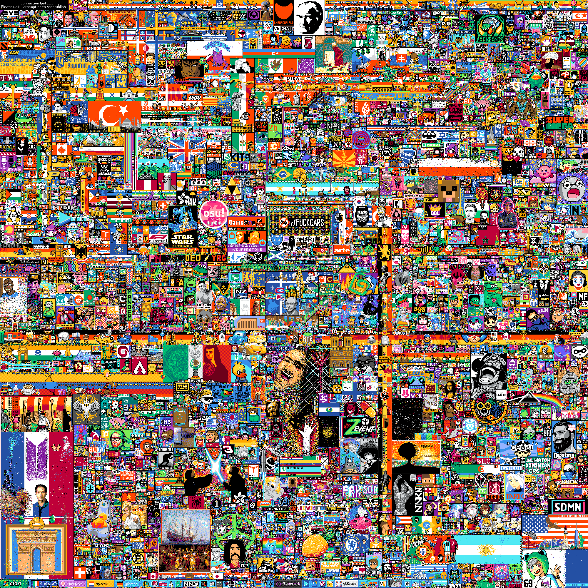
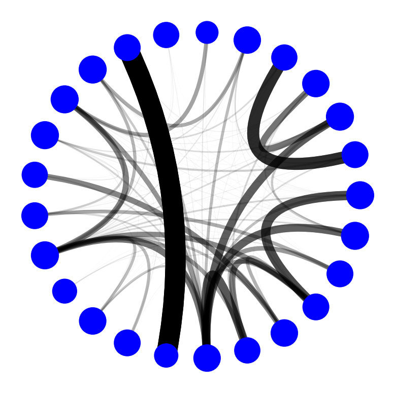
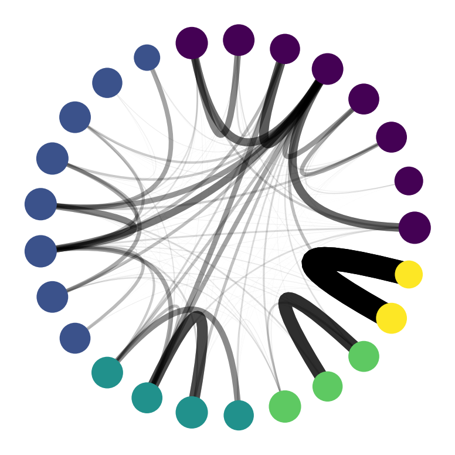
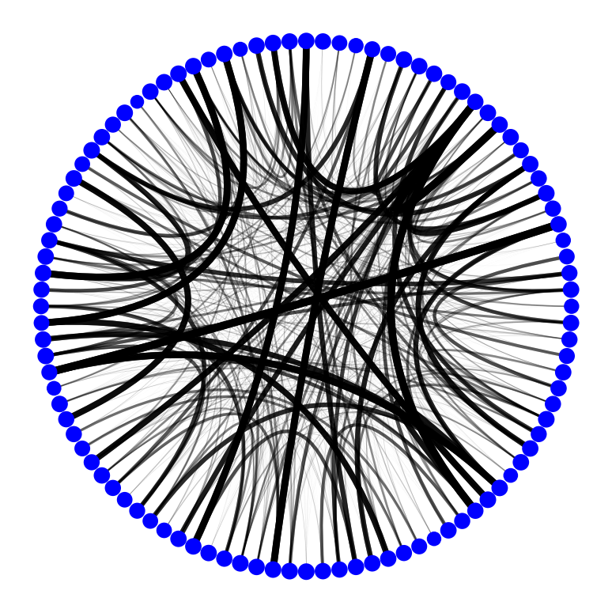
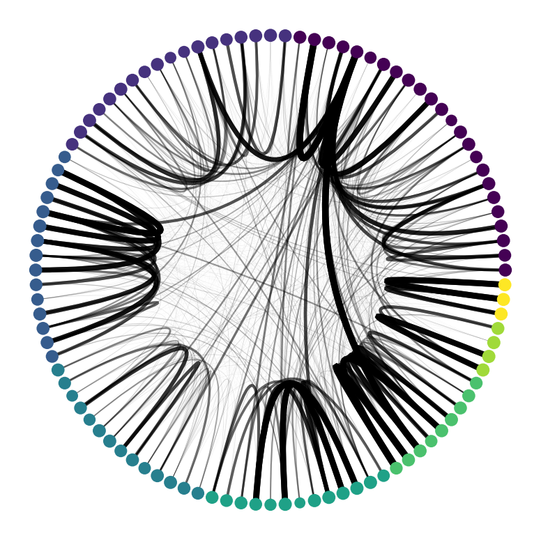

# Network of collaborations in r/Place 2022
I thought that it would have been cool to study and try to visualize the interaction between contributors of the Reddit Place 2022 event. If you don't know what it is: [r/place](https://www.reddit.com/r/place/) or watch the [timelapse](https://www.youtube.com/watch?v=K5O3UgLG2Jw).

I took a network science course titled **[Complexity in social systems](https://fisica-sc.campusnet.unito.it/do/corsi.pl/Show?_id=4ef1)** and decided to bring this work as final project and it was really appreciated (or maybe I just have been lucky to have the professor nerdy enough to appreciate it).




## Description
The initial question of the project was if it's possible to group contributors in communities based on which artwork they have contributed to.
It turns out to be not an easy task due to the **huge** number of users and their activity. To give an idea:
- 160 million pixel modified
- 10 million unique users
- almost 10k different artworks

Then I had to make some simplifying assumptions. Unfortunately, it would be difficult to explain here every step, but [here](https://github.com/pietro-sillano/r-place-Network-Analysis/blob/main/docs/Reddit_place_ENG.pdf) you can find the presentation slides with the main steps.

# Results
   

That's the **network representation** for 25 (and 100) artworks respectively. Each node is an artwork and nodes linked together share contributing users. The width of the link represents the number of shared users.

The figures with coloured nodes are the network representation after the community detection algorithm (Newman modularity algorithm). Communities are different artworks that shared same users. This could be a signal for **collaboration** and **competition** too.

> **Note:** the figures above were made with the first version of the pipeline, which had
> the artwork outlines transposed (x and y swapped) and counted pixels of nested artworks
> twice. The code has been fixed (see below); the figures will be updated once the
> pipeline is rerun on the full dataset.

# Future developments
- Analyze the collaboration / competition relationships
- Consider the dynamics and evolution of the canvas over time

# How to run
```bash
python3 -m venv .venv && source .venv/bin/activate
pip install -r requirements.txt
scripts/run_pipeline.sh      # download (~12 GB) -> trim -> statistics -> networks
pytest                       # tests on synthetic data, no download needed
```
Every step can also be run on its own from the repository root, e.g.
`python -m rplace.bipartite random100` then `python -m rplace.network random100 --min-pixels 3`.

# Structure
```
├── rplace/
│   ├── config.py      paths, analysis window, constants
│   ├── trim.py        raw csv (20 GB) -> data/reddit_trimmed.parquet: minutes since the first pixel (UTC),
│   │                  integer user ids, colour index, x/y; admin actions removed
│   ├── atlas.py       artwork outlines from data/atlas.json (the version valid in the analysis window)
│   ├── stats.py       dataset statistics and figures (pixels per user, heatmap, activity, areas)
│   ├── bipartite.py   artwork-user network; each pixel belongs to the smallest artwork containing it
│   └── network.py     projections, null model, backbone, spatial control, Leiden communities, circos plots
├── scripts/
│   ├── download.sh    official r/place 2022 dataset
│   └── run_pipeline.sh
├── tests/             synthetic-data tests (orientation, time zones, planted communities, end to end)
├── data/atlas.json    the r/place atlas (artwork outlines)
├── output/            generated tables (edges, pairs, communities)
├── assets/plot/       figures
└── docs/              presentation slides (ENG / ITA)
```

# Methods
Two artworks are linked when they share contributors (users that placed at least
`--min-pixels` pixels in both, during the window from the second canvas expansion to the
final whiteout). Raw shared-user counts mostly reflect artwork size, so `rplace.network` also computes:

- **normalised weights**: Jaccard, cosine and Newman's collaboration weight;
- **statistically validated network** ([Tumminello et al. 2011](https://doi.org/10.1371/journal.pone.0017994)):
  the overlap of each pair is tested against a hypergeometric null model (users spread at random),
  keeping pairs with significantly more shared users (Benjamini-Hochberg FDR < q).
  The edge weight is the lift, observed / expected shared users;
- **disparity-filter backbone** ([Serrano et al. 2009](https://doi.org/10.1073/pnas.0808904106)) of the raw projection;
- **spatial control**: adjacent artworks share users also because of border fights and misplaced
  pixels, so adjacent pairs are flagged and the analysis is repeated without them;
- **communities** with Leiden (modularity) on each projection, and with bipartite CPM directly
  on the artwork-user network (exploratory: its resolution is a heuristic).

The original random selections of 25 and 100 artworks were drawn without a seed; the
`random25` / `random100` selections are seeded re-draws with the same criteria (area between 5,000 and 100,000 pixels).

# Contributing
Any kind of suggestion or contribution is welcomed.
